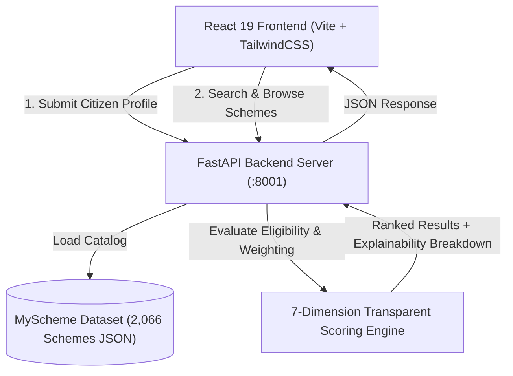

<div align="center">

# 🏛️ Sahayak AI (सहायक AI)
### Government Welfare Scheme Advisor & Explainable Match Engine

[](https://react.dev/)
[](https://www.typescriptlang.org/)
[](https://fastapi.tiangolo.com/)
[](https://tailwindcss.com/)
[](https://www.myscheme.gov.in/)
[](LICENSE)

*Empowering Indian citizens to discover government benefits through a 100% private, transparent, and explainable multi-criteria ranking engine.*

[Explore Features](#-key-features) • [System Architecture](#-system-architecture) • [Getting Started](#-getting-started) • [API Reference](#-api-endpoints) • [Scoring Engine](#-how-the-scoring-engine-works)

---

</div>

## 📌 Overview

**Sahayak AI** is a digital public service platform built to solve the discoverability crisis in government welfare. While thousands of Central and State schemes exist across India, citizens routinely miss out due to complex eligibility criteria and fragmented information.

Sahayak AI bridges this gap by indexing over **2,066 welfare schemes** from the official **MyScheme** repository, mapping them against citizen profiles using a transparent, multi-dimensional scoring algorithm that explains *exactly why* a scheme was recommended.

> **🛡️ Privacy First**: Sahayak AI requires **no Aadhaar, no phone numbers, no bank details, and no document uploads**. Recommendations are completely preliminary and anonymous.

---

## ✨ Key Features

- 📝 **Intelligent Intake Questionnaire (`/find`)**:
  - 10 structured profile questions covering State, Age, Gender, Education, Occupation, Income Range, Residence Type, Social Category, and Support Types.
- 🎯 **7-Dimension Transparent Scoring (`/results`)**:
  - Detailed score breakdown for every scheme with explicit reasoning ("Why Matched" rationale + cautionary exclusion flags).
  - Categorized into clear score bands: **Strong Match** (≥60%), **Moderate Match** (≥40%), and **Low Match** (<40%).
- 🔍 **Interactive Scheme Catalogue Explorer (`/explore`)**:
  - Full-text search and filtering across thousands of Central and State schemes.
  - Category filters, state filtering, and detailed scheme modals displaying eligibility rules, benefits, and direct links to official application portals.
- 👤 **Pre-Configured Personas Simulator (`/personas`)**:
  - Test real citizen scenarios instantly (e.g., smallholder farmer from Bihar, college student in UP, urban woman micro-entrepreneur in Maharashtra).
- ⚙️ **Administrative Portal (`/admin`)**:
  - Dataset health checks, portal statistics, and dataset refresh capabilities.

---

## 🏗️ System Architecture



---

## 🧮 How the Scoring Engine Works

The backend recommender evaluates schemes across **7 weighted criteria** totaling 100%:

| Dimension | Weight | Evaluation Method & Logic |
| :--- | :---: | :--- |
| **Needs Relevance** | **35%** | Text overlap matching stated support needs (Agriculture, Education, Healthcare, etc.) against scheme tags, descriptions, and benefits. |
| **State / Coverage Fit** | **20%** | 100% for state-specific matches; 85% for Central schemes applicable nationwide; schemes from other states are excluded. |
| **Age Fit** | **15%** | Evaluates explicit numerical age thresholds (min/max bounds) and seniority tags against the citizen's age. |
| **Income Fit** | **10%** | Matches low-income / BPL criteria with income brackets. |
| **Gender Focus** | **10%** | Prioritizes women-centric programs (e.g., maternity, Beti Bachao) if beneficiary is female. |
| **Social Category** | **5%** | Detects SC, ST, OBC, minority-focused initiatives. |
| **Residence Fit** | **5%** | Tailors schemes to Rural vs. Urban jurisdictions. |

---

## 📁 Repository Structure

```
.
├── backend/                  # FastAPI Python backend
│   ├── data/
│   │   └── schemes.json      # Complete offline snapshot of 2,066 schemes
│   ├── lib/
│   │   └── recommender.py    # 7-dimension scoring & explainable ranking logic
│   ├── models/
│   │   └── schemes.py        # Pydantic schemas mirroring frontend types
│   ├── main.py               # REST API endpoints & route handlers
│   └── requirements.txt      # Python dependencies (FastAPI, Uvicorn, Pydantic)
│
├── src/                      # React 19 Frontend
│   ├── components/
│   │   ├── layout/           # Header, Footer
│   │   ├── schemes/          # CitizenProfileForm, SchemeCard, SchemeDetailDialog
│   │   └── ui/               # Tailored UI components (Badge, Button, Dialog, Select, etc.)
│   ├── lib/
│   │   ├── api.ts            # Typed HTTP client with error boundaries
│   │   ├── options.ts        # Demographic options & demo personas
│   │   ├── queryClient.ts    # React Query caching layer
│   │   ├── types.ts          # TypeScript type definitions
│   │   └── utils.ts          # Styling helper utilities
│   ├── pages/
│   │   ├── Home.tsx          # Hero page with live simulator
│   │   ├── FindSchemes.tsx   # Questionnaire intake wizard
│   │   ├── Results.tsx       # Ranked recommendation feed
│   │   ├── Explorer.tsx      # Searchable scheme explorer
│   │   ├── DemoProfiles.tsx  # Pre-built citizen personas
│   │   └── Admin.tsx         # Dataset management interface
│   ├── App.tsx               # App router
│   ├── index.css             # Tailwind CSS tokens & styling
│   └── main.tsx              # React mounting root
│
├── public/                   # Static favicon and branding assets
├── package.json              # NPM dependencies & scripts
├── vite.config.ts            # Vite proxy & build configuration
└── tsconfig.json             # TypeScript configuration
```

---

## 🚀 Getting Started

### Prerequisites

- **Node.js**: v18.0.0 or higher
- **Python**: v3.10 or higher
- **Git**

---

### Step 1: Clone the Repository

```bash
git clone https://github.com/Upasana-Mukherjee-777/sahayak-ai-schemes.git
cd sahayak-ai-schemes
```

---

### Step 2: Set Up & Run the Backend

```bash
cd backend

# Create virtual environment
python -m venv venv

# Activate virtual environment
# Windows (PowerShell):
.\venv\Scripts\activate
# Linux / macOS:
# source venv/bin/activate

# Install dependencies
pip install -r requirements.txt

# Run FastAPI server
uvicorn main:app --host 127.0.0.1 --port 8001 --reload
```
*The backend API will start at `http://127.0.0.1:8001`. You can view Swagger documentation at `http://127.0.0.1:8001/docs`.*

---

### Step 3: Set Up & Run the Frontend

In a new terminal window from the root directory:

```bash
# Install NPM packages
npm install

# Start the Vite development server
npm run dev
```

*Open **`http://localhost:3000`** in your browser. All `/api/*` network requests are automatically proxied to the backend at `http://localhost:8001`.*

---

## 🔌 API Endpoints

| Method | Endpoint | Description |
| :--- | :--- | :--- |
| `GET` | `/api/meta` | Retrieves catalogue metadata, state lists, categories, and totals |
| `GET` | `/api/schemes?q={query}&page={page}` | Paged list of schemes with text search |
| `GET` | `/api/schemes/{slug}` | Detailed scheme information (eligibility, benefits, application steps) |
| `POST` | `/api/recommendations` | Runs multi-factor scoring against a submitted `CitizenProfile` |
| `POST` | `/api/admin/login` | Admin authentication endpoint |

---

## 📜 Dataset Source & Disclaimer

- **Dataset Source**: Snapshot of the Government of India [MyScheme Portal](https://www.myscheme.gov.in/) curated under the Apache-2.0 license.
- **Disclaimer**: *Recommendations provided by Sahayak AI are preliminary text-based matches. Welfare policies, eligibility thresholds, and benefits change periodically. Citizens must always verify requirements and submit applications through official government portals.*

---

<div align="center">

Developed with ❤️ for Indian Citizens • Open Source Apache-2.0

</div>
